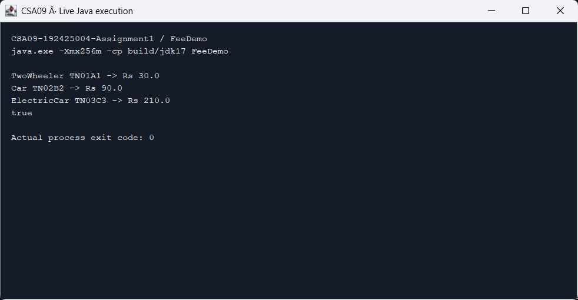
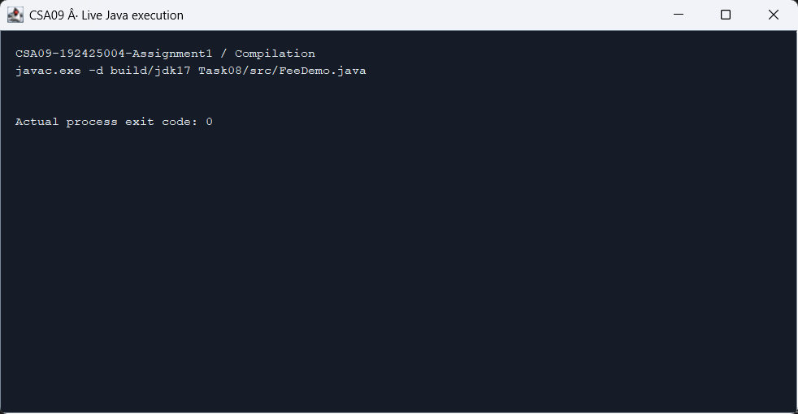
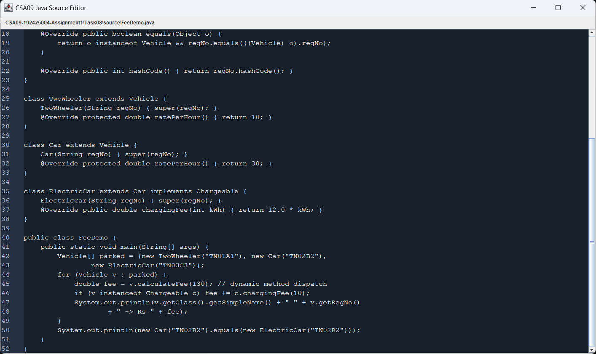
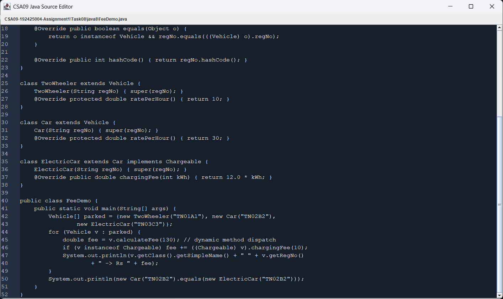
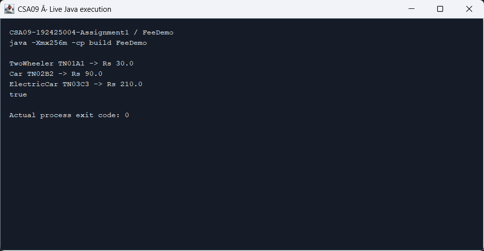
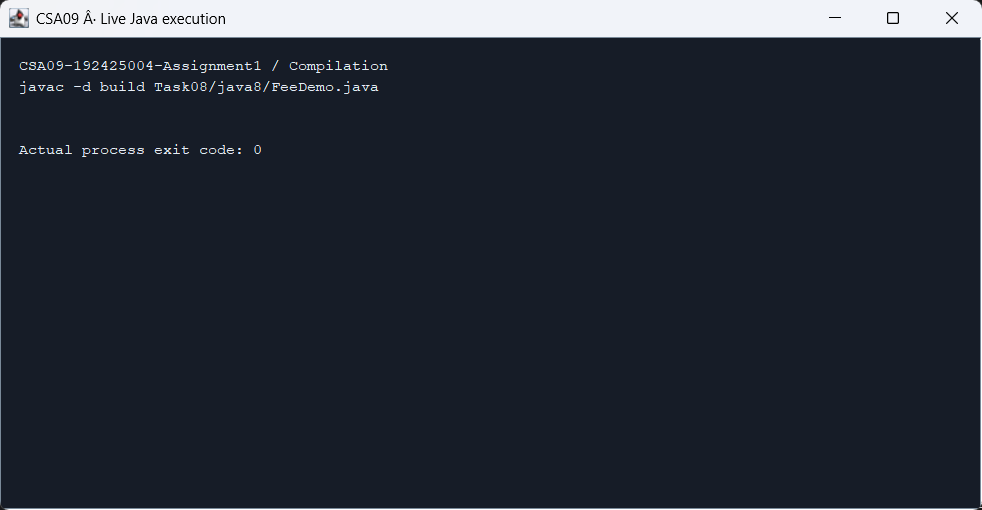

# Task08 · Task 8 · Polymorphism

[Full answer](ANSWERS.md) · [Inputs](input/README.md) · [Logs and measurements](evidence)

JDK 17 template: `javac -d build Task08/source/FeeDemo.java`, then `java -cp build FeeDemo`.

## Screenshots

More captures

